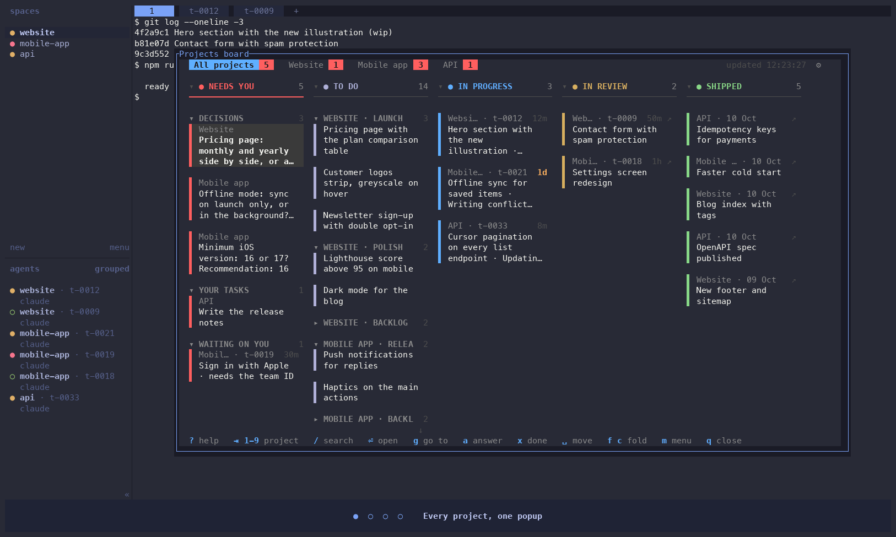
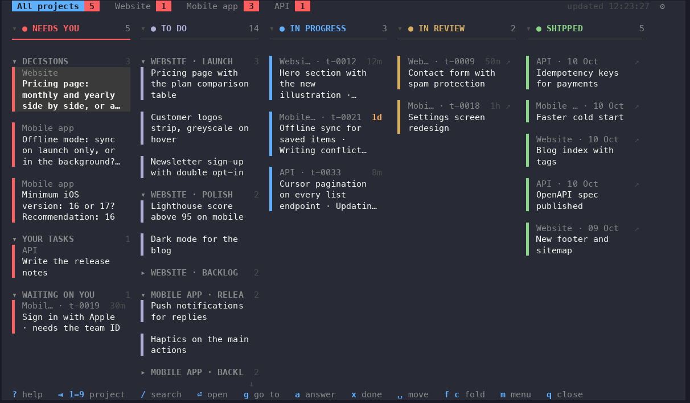
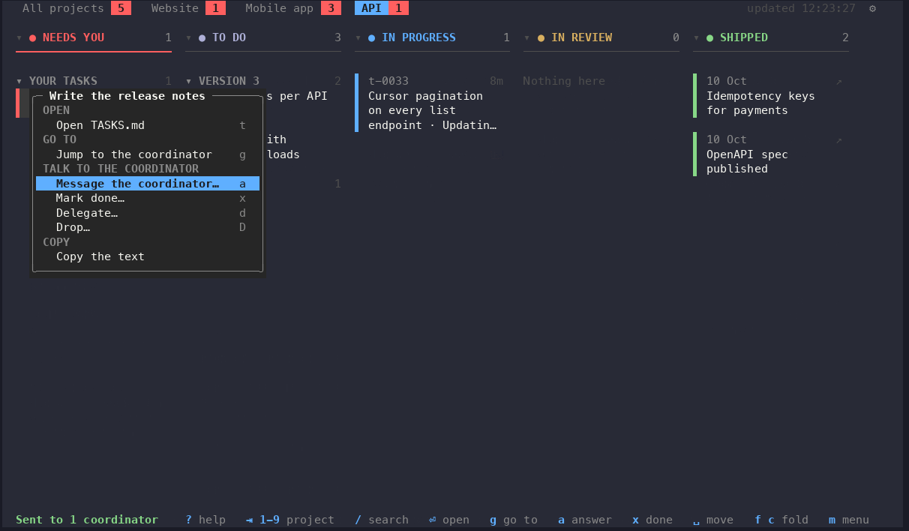
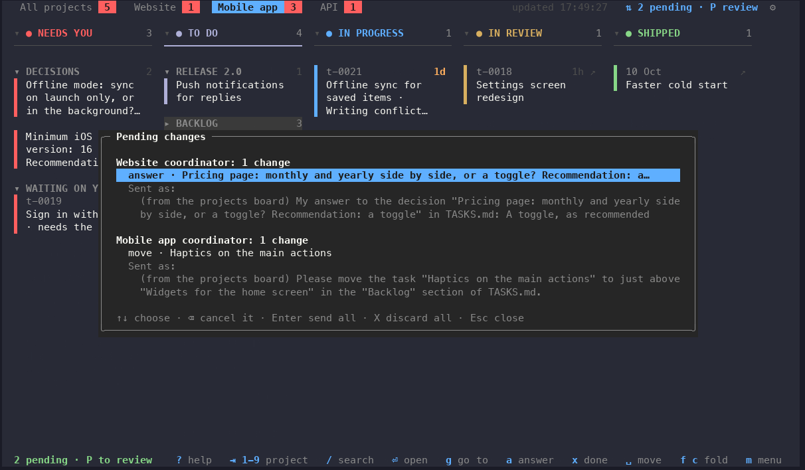
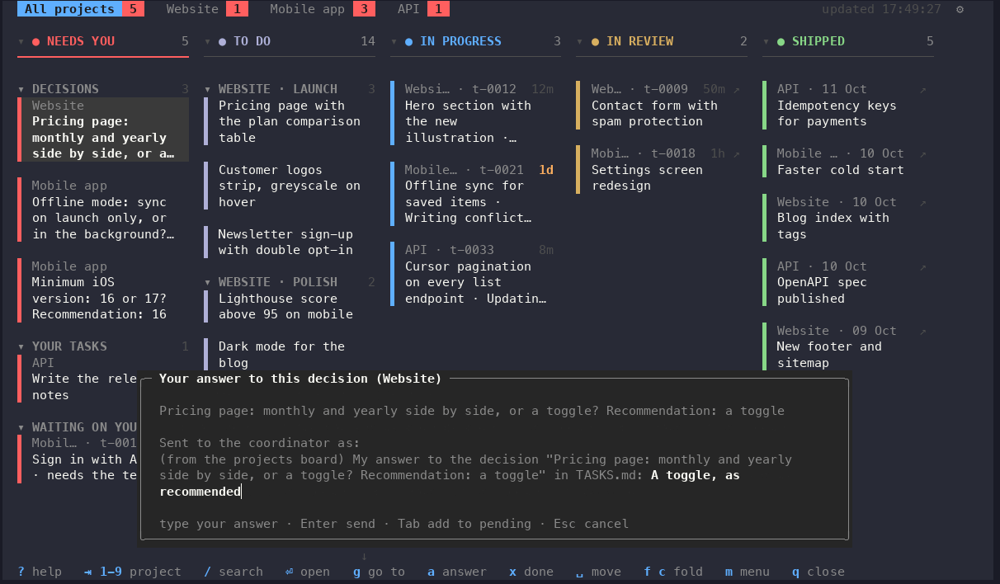

<div align="center">

# Projects board

*A kanban board for [herdr-projects](https://github.com/eliasstravik/herdr-projects). See where every project stands, and act on it, without leaving herdr.*

[](https://github.com/mwellck/herdr-projects-board/actions/workflows/test.yml)


[](LICENSE)

[Install](#install) · [What it shows](#what-it-shows) · [Talking to the coordinator](#talking-to-the-coordinator) · [Keys](#keys-and-mouse) · [FAQ](#faq) · [Contributing](#contributing)



<sub>Recorded in herdr, with sample projects.</sub>

</div>

<table>
<tr>
<td width="33%" align="center" valign="top">

<h3>🙋 Your agents ask</h3>

Decisions, tasks for you and stuck threads from every project land at the top of one board.<br><br>

</td>
<td width="33%" align="center" valign="top">

<h3>💬 You answer from the board</h3>

Reply, reorder, delegate or drop from the card. Each message is shown before it goes.<br><br>

</td>
<td width="33%" align="center" valign="top">

<h3>🔁 They keep going</h3>

Work moves from queued to running, review and shipped. When they need you again, it's back on top.<br><br>

</td>
</tr>
</table>

## Install

```sh
herdr plugin install mwellck/herdr-projects-board
```

Then bind a key in herdr's `config.toml`:

```toml
[[keys.command]]
key = "prefix+t"
type = "plugin_action"
command = "herdr-projects-board.open"
description = "projects board"
```

`prefix+t` is available by default, but [tsk](https://github.com/smarzban/tsk) suggests it too: pick another, such as `prefix+shift+t`, if you use both.

Needs herdr 0.9.1 or later, herdr-projects with `thread list --json` (tested with 0.2.34), and Python 3.9 or later. It uses the standard library only, so the `python3` that macOS ships works. Remove it with `herdr plugin uninstall herdr-projects-board`.

For the inbox, routines, settings and memory, use herdr-projects' native popup (`prefix+a` by default).

## What it shows

### Every project on one screen



The first tab merges every project's columns, each card naming its project. Then one tab per project. A red count on a tab means that project needs you.

| Column | From |
|---|---|
| **Needs you** | **Decisions** (`DECIDE:` tasks: answer them), **Your tasks** (assigned to you with `(me)`) and **Waiting on you** (threads stuck until you look) |
| **To do** | the other open tasks in TASKS.md, grouped by their `##` section, unless a running thread already has them. Backlog starts folded |
| **In progress** | threads at work, with their latest activity and how long since they last changed |
| **In review** | threads with an open pull request or a report ready for review |
| **Shipped** | threads whose pull request merged in the last 14 days by default |

### Every action in one menu



Press `m` or right-click a card: everything you can do with it, grouped, with each shortcut shown.

### Reprioritise, review, then send



In herdr-projects, a task's place in TASKS.md is its priority: coordinators work top to bottom. So a moved task shows in its new place, marked *moved · pending*. Answers and task actions can wait too: press Tab instead of Enter in their box. Gather as many as you like, across projects, then press `P`: each project's changes become one sentence to its coordinator, and Enter sends them all.

<details>
<summary>Moving, cancelling and sending in detail</summary>

- **To move something:** press Space on a task or a section heading (or choose Move… from its menu), use ↑/↓ or the scroll wheel, then press Space or click to drop it. Esc puts it back.
- **Tasks** move within their project. Going past a section's edge takes a task into the next section, which is how a backlog item gets promoted.
- **To cancel something:** press Backspace on its card: its pending action goes first, then its move. In the review (`P`), ↑/↓ picks a change and Backspace cancels it; `X` discards everything pending.
- **Sent moves** stay in place, marked *sent*, until TASKS.md has them (for up to 15 minutes). Pending changes are kept if you close the board.
- **Sections** (Stage 1, Backlog…) are the board's own order: a moved section is saved straight away and nothing is sent. Moving Backlog to the top once keeps it there.

</details>

<details>
<summary>Folding</summary>

Every section and every column folds, and folds are kept between runs.

- **A folded section** shows as one line with its count, for example `▸ BACKLOG  4`.
- **A folded column** shrinks to a narrow strip with its count.
- **Mouse:** click a heading to fold or open it.
- **Keys:** `f` folds the selected card's section, `F` every section in the column, `c` the column.
- **Backlog** sections start folded until you open one.
- **Needs you groups** fold for every project at once. Other sections fold per project.

</details>

## Talking to the coordinator



Changes go to the project's coordinator through `herdr-projects coordinator prompt`, the channel herdr-projects' native popup uses. The coordinator stays the only writer of TASKS.md and does its usual bookkeeping.

| Key | On | Sends |
|---|---|---|
| `a` | a decision | your answer: *My answer to the decision "…": Postgres, as recommended* |
| `a` | any other card | a note about it: *About thread t-0009 "…": hold the merge until I've tested it* |
| `x` | a task | *Please mark as done the task "…"* |
| `d` | a task | *Please delegate the task "…"* (the coordinator starts a thread within its usual limits) |
| `D` | a task | *Please drop the task "…"* |

Mark done, delegate and drop send their sentence as is when you press Enter, or you can type a note first: *… Note: done in PR #12, tested on staging.*

Press Tab instead of Enter to keep it pending and send it later, in one message with the project's other changes (`P`). The card shows what's waiting, such as *done · pending*. Opening the box on it again lets you edit it, and Backspace cancels it. Marking a task done, delegating or dropping it replaces its pending move, which no longer matters.

## Keys and mouse

`?` shows them all on the board.

<details>
<summary>Every key</summary>

| Key | Does |
|---|---|
| `?` | help |
| Tab, Shift-Tab, `1`–`9` | switch project (`1` is All projects) |
| arrows or `h j k l` | move between columns and cards |
| `/` | search every card; Esc clears |
| Enter | open the card's pull request; on a section heading, fold it; on a folded column, open it; while moving, drop |
| `g` | go to the card's thread, or to the coordinator |
| `a`, `x`, `d`, `D` | answer, mark done, delegate, drop; in their box, Enter sends now and Tab adds it to the pending changes |
| `f`, `F`, `c` | fold the section, every section, the column |
| Space | pick up a task or a section in To do; ↑/↓ moves it; Space drops it; Esc puts it back |
| `P` | review the pending changes and send them |
| Backspace | cancel the card's pending change |
| `m` | the card's menu |
| `t` | open the project's TASKS.md in a herdr tab |
| `s` | settings |
| `r` | refresh now (it also refreshes on its own, in the background, so keys never wait) |
| `q`, Esc | close |

With the mouse: click a project or a card, click a selected card to open its pull request, scroll a column, right-click a card or a project for its menu, click a heading to fold it, click ⚙ for settings.

</details>

## Colours and settings

The board follows herdr's theme: it reads herdr's config wherever herdr does (`HERDR_CONFIG_PATH`, `$XDG_CONFIG_HOME/herdr`, or `~/.config/herdr`), including `[theme.custom]` and auto light/dark.

<details>
<summary>Colours in detail</summary>

- **Custom colours** are used exactly as you set them.
- **Built-in themes** use each theme's published palette, so they can differ from herdr's by a shade.
- **Exact colours:** in terminals that allow it (herdr does), the board sets your theme's exact colours and restores the terminal's on close. Elsewhere it uses the nearest of the 256 standard colours.
- **The `terminal` theme, or a theme the board doesn't know,** falls back to the board's own soft palette.

Under settings, **Colours** switches between `herdr` (the default), `soft` (the board's own palette) and `terminal` (your terminal's 16 colours).

</details>

<details>
<summary>Settings</summary>

Press `s`, or click ⚙.

- **General:** how often the board refreshes, whether it closes after you send something (off by default), the colours, and which editor opens TASKS.md and reports. The editor list offers what's installed: terminal editors open in a herdr tab, GUI ones (VS Code, Cursor, Zed, Sublime) in their own window. The default is herdr's `$EDITOR`, which is vi when unset.
- **Cards:** whether reviewer threads show, when a thread counts as untouched, and how far back Shipped looks.
- **Layout:** **Reset folds and section order** puts the layout back to how it started.

Settings are saved to `config.toml` in the plugin's config dir (`herdr plugin config-dir herdr-projects-board`). There you can also set the projects root and the herdr-projects binary by hand: see [config.example.toml](config.example.toml).

</details>

## FAQ

**Does it change my files?**
No. It reads herdr-projects' output and TASKS.md. Every change is a sentence to the coordinator, shown to you first.

**Why does a moved task say *pending*?**
A task's position is its priority, so a move is a real change for the coordinator. Moves, and the answers and actions you add with Tab, wait until you review them with `P`, so you can batch several, across projects, into one message per project.

**Does it work on Windows?**
No. herdr runs on Windows, but herdr-projects, which the board reads, supports macOS and Linux only. If herdr-projects adds Windows, the board would follow; it would also need a terminal library, since the Windows Python doesn't ship curses.

**Can I check my setup without herdr?**
`python3 bin/board --once`, run from the plugin's folder, prints the board as plain text: every project, or one with `--once SLUG`. It's also handy to attach to a bug report.

## Contributing

Issues and pull requests are welcome.

- Open an issue first for anything bigger than a fix, so we can agree on it before you build it.
- Keep a pull request to one change, and say what it changes and why.
- The board uses Python's standard library only and supports Python 3.9: please keep it that way.
- Run the tests before opening a pull request: `python3 -m unittest discover -s tests`
- If your change alters what the board looks like, refresh the GIF and screenshots in `docs/images/` with `python3 demo/record.py`. It runs herdr with a throwaway home on made-up projects, so nothing of yours appears. It needs [agg](https://github.com/asciinema/agg) and ffmpeg.

## License

[MIT](LICENSE)
